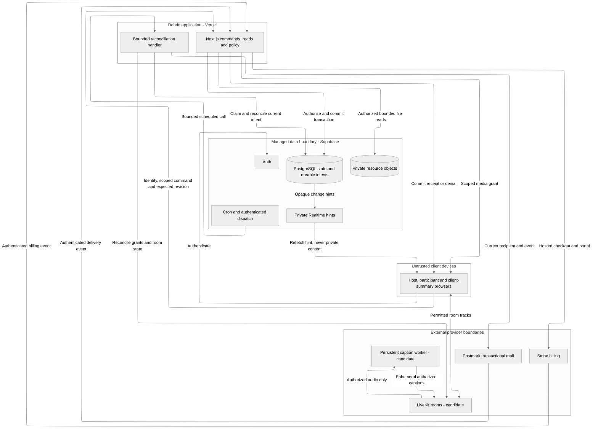

# Debrio architecture

P0-02 proposal, 18 November 2026. The [PRD](docs/Debrio_PRD_v0.5.md) is the product source. [ADR 0001](docs/adr/0001-modular-application.md) accepts one modular application/database with managed media and narrow jobs. [Q55](docs/engineering/STACK-PROPOSAL.md) accepts the initial stack; it does **not** accept the new mechanisms below or certify provider feasibility. There is no production application, schema, worker or deployed environment in this repository. The historical `demo/` is not the implementation.

Read [GLOSSARY.md](GLOSSARY.md), [settings and account evidence](docs/engineering/STACK-SETTINGS.md), and the [decision/proof register](docs/tasks/P0-02/spec.md). D1–D6 below are proposed until the decision owner confirms them. Media approval remains P1-06. No account, price, resource or capacity is inferred from an example name.

## System and data flow

Commands commit before success is shown. Media transport never owns workshop state. File reads return through the authorization boundary; large uploads use a quarantined upload grant described below. Cron and the handler are a proposed deployment path, not running infrastructure. The caption worker is persistent and separate from web requests; the periodic handler is not its runtime. All provider arrows require environment-specific credentials and policy.

## Accepted stack and strongest alternative

| Area | Accepted choice / proposed detail | Boundary, cost driver and strongest alternative |
|---|---|---|
| Frontend/backend | Next.js/React/TypeScript; short Node route handlers | UI calls domain commands; no process-local workshop state. Function execution/build/transfer usage. Alternative: Vite frontend plus a separate Node API, which adds a deployment and auth/contract coordination without an established need. |
| Database | Supabase PostgreSQL | Transactions, constraints and row policies own durable state. Compute, connections, storage, backup allowance. Plain managed PostgreSQL is the credible exit but requires replacing integrated Auth/Storage/Realtime policy. |
| Identity | Supabase Auth for accounts; D1 private guest sessions | Account assurance is not session admission. Auth users/email/abuse limits. A separate OIDC provider adds integration and does not remove Debrio guest/admission policy. |
| Task updates | Private Supabase Realtime, D3 opaque hints plus authorized reads | Messages/connections/egress. Authorized polling alone is simpler and is the recovery path; latency/load must meet PRD targets. Neither a channel nor presence is a source of authority. |
| Media/captions | LiveKit Cloud and managed caption worker candidate | One provider room per main/breakout; narrow room/grant adapter. Participant and extra facilitator connections, relay/egress, worker minutes and STT streams. Another managed SFU/STT combination is an exit if Phase 1 fails, requiring the same proof; no second conferencing app or self-hosted fleet is silently selected. |
| Resources | Private Supabase Storage | Object versions, bytes, download/egress and validation cost. Separate S3-compatible storage is credible but adds credentials and restore coordination. |
| Hosting/jobs | Vercel web/API; D2 Supabase Cron dispatches bounded Vercel reconciliation | Request duration and scheduled calls; persistent media stays outside. Vercel scheduling is an alternative only after cadence/allowance evidence; an always-on general backend adds idle cost/operations. Render stays excluded. |
| Mail/billing | Postmark application API and Auth SMTP; Stripe Checkout/Billing/portal | Sends/provider retention and payment/billing fees. Keep financial records at Stripe and workshop permissions at Debrio. Existing decisions are retained. |
| CI/test | GitHub Actions, locked tooling, Vitest, real PostgreSQL and Playwright | CI minutes/artifacts and private evidence retention. A separate CI host adds setup without a requirement. P0-03 pins versions and records executable commands. |

The strongest whole-system alternative is a static React frontend with a separately hosted general Node API, retaining managed PostgreSQL/media. It gives longer-lived backend execution but adds another application deployment, credentials and operational responsibility. The accepted modular Next.js shape is smaller for short commands. Persistent caption processing alone does not justify splitting every module into a service. No generic multi-provider framework is proposed.

## Module ownership and dependency direction

These are modules inside one application, not separate deployments. Browser/provider handlers call module interfaces; modules call their own persistence/provider implementations. Provider SDKs and UI types do not enter instructional rules. No module writes another module's records directly. A command needing several owners uses one transaction with their functions; cross-provider work follows committed intents, never a distributed transaction.

| Module | Owns | Permitted dependencies / public work |
|---|---|---|
| Access | Accounts, workspace membership/owner, delegated capabilities, invitations, participant identity, admission, endpoint epoch | Auth verification; authorize scoped action, admit/recover identity, accept ownership transfer. No billing-to-content privilege. |
| Billing | Workspace-to-Stripe mapping, entitlements, tester redemption, grace and exemption | Access for billing authority; returns hosting eligibility with absolute deadline. No dependency on session internals. |
| Execution | Frozen workshop versions, session/activity/round state, group/role mappings, admission reservations and deadlines | Access and Billing; preview/start/advance/reassign/end using expected revisions. Owns atomic global and workspace admission. |
| Evidence | Structured drafts, attempts, rubric/feedback/routing snapshots, debrief, approvals and export projections | Access and Execution's scope/assignment facts; save/submit/revise/approve/export. Never asks the media provider who owns work. |
| Resources and collaboration | Resource versions/assignments/releases, playback, messages/help and delivery recipients | Access and Execution; fixed Evidence snapshots through its interface, without making Evidence depend on Resources. |
| Media | Room mappings, current route intent, notices, transfers, provider connection state and caption authorization | Access and Execution; reconcile desired routes through a narrow LiveKit adapter. Resource playback interruption uses committed playback intent; resources never depend on provider state for access. |
| Delivery/operations | Job claims/retries, mail metadata, callback receipts, lifecycle reconciliation and diagnostics | Invokes the owning module's reconcile function. Producers store typed intents in their transaction; they do not call this runner. Policy is rechecked by the owner, not duplicated in the dispatcher. |

Deletion/closure coordinates these owners explicitly. No unrestricted cross-module query is exposed to the UI. There is no additional ORM, event bus, cache service or abstraction for hypothetical providers in this proposal.

## Data and identity contracts

Use opaque stable IDs and workspace/session scoping on all applicable keys and foreign-key relationships. Composite scope constraints prevent linking another workspace's activity, attempt, resource or subscription. Row-level policies on exposed tables supplement command authorization; migration/operator credentials are separate from ordinary request credentials. Privileged database functions have a fixed search path, narrow execution grants and explicit actor checks. Exact migrations belong to their feature tasks and must follow [migration titles](docs/engineering/WORKFLOW.md#migration-titles).

| Aggregate | Required relationships and consistency |
|---|---|
| Workspace | Exactly one primary owner; accepted recipient transfer is atomic. Optional team, no company requirement. Workspace membership, billing authority and session capability are separate grants. Owner departure cannot orphan content or transfer platform exemption. |
| Workshop/session | A session references a frozen ready workshop version and policy snapshot. Activities and sequential steps belong to that session. Live overrides retain history; copied workshops exclude participants, work and approvals. |
| Participant/group/role/room | Participant identity is per session, account reference optional. Group/role assignments have effective revisions and jigsaw home/expert mappings. Room assignment and provider connection are separate. Visiting a room grants no private group resources. |
| Draft/attempt | Exactly one owner: participant session identity XOR group. Submitter is separate. Compare expected draft and assignment revision; lock membership/recorder while submitting. Immutable attempt contains output revision, ordinal, predecessor and the full contributor roster at commit. Replacement recorder changes permission, not authorship. |
| Feedback/routing | Fixed attempt and rubric versions; separate author, subject and assigned audience. Later corrections never mutate already consumed input or approval. Closing a round ends reviewer access; subject retention follows current policy. |
| Resources/releases | Fixed resource version and allocation to individuals/groups/roles; release is an additional condition. Store recipients before notifying. Historical contributor grants cover only contributed submitted snapshots, not former private briefs or future drafts. New members need an explicit grant to older submissions. |
| Publication | Preview identity/content/version/audience; author approval, plus subject for expanded feedback, or every snapshotted group contributor for external-client publication. Withdrawal/source expiry immediately denies fresh reads and exports. Changed copies/audiences require new approvals. |
| Jobs/events | Scope, event/command ID, actor, revision, schema version, timestamp, correlation, due time, attempt/lease and result. Minimal payload references current records; no captions, auth tokens or raw card data in logs. |

**D1 proposed identity detail:** Supabase verifies host accounts; defer the exact host login method to P2-01. Server-verified account linkage never grants admission or workspace membership. Guests receive a high-entropy private session credential in a Secure/HttpOnly/SameSite cookie after lobby admission; store only its hash, expiry and endpoint epoch. Route guest data through authorized server handlers. Shared invitation links/display names never retrieve an old identity. Recovery needs facilitator verification, rotates the private credential/epoch, rejects old-device writes and terminates old media before explicit takeover. Same-site cookie mutations require origin/CSRF validation. Guest-to-account conversion is deferred. Authenticated participants retain separate identities per session.

Required MFA assurance is checked server-side for operator/owner/billing/data roles, including assignment and recovery; enrollment alone is insufficient. Scope every request using current membership/capability, never a browser-selected workspace or stale role claim. Data administrators can perform scoped deletion without acquiring general live-listening permission. Host recovery, account closure and workspace transfer are separate from guest recovery (R6).

## Commands, acknowledgement and durable reconciliation

Commands carry a stable operation ID, scope and expected revision. In one transaction, verify current identity/permission/deadline, compare revision, apply the state change, store deduplication result and durable side-effect intents. Return success only after commit. An identical retry returns the committed result; same ID with different content is rejected. Conflicts return current version and retain the user's unsaved content for explicit recovery. Do not auto-merge by last-write-wins. Browser-local pending text is volatile initially; refresh/close warns about unsaved work, and no offline durable-save guarantee is made.

**D2 proposed runner:** Supabase `pg_cron` invokes a restricted Vercel handler through `pg_net` using a dedicated dispatch secret held in Vault; never put a general database/provider secret in the dispatch payload. A handler claims due intents with a database lease, commits the claim, performs bounded external calls and stores outcomes. The immediate command path can attempt the same claimed work after commit while awaiting its response, but scheduled retry must not depend on that request/browser surviving. The handler is part of the application, not a new service. Validate runtime timeout, scheduler extensions and allowance in the selected accounts before enabling it. This path is supported in principle by [Cron](https://supabase.com/docs/guides/cron) and [scheduled HTTP dispatch](https://supabase.com/docs/guides/functions/schedule-functions); it is not a configured integration.

Initial test parameters, **proposed**: dispatch every 10 seconds, at most one active dispatcher per environment, batches of 20, 20-second invocation budget, 5-second external-call timeout and 30-second claims. Retry recoverable failures after 10/30/60 seconds then up to five minutes with jitter; after eight failures show failed/needs-operator state and alert. Revocations remain denied in authoritative policy and on the R1 lease path even when cleanup fails; they do not become grants after retry exhaustion. Reconcile provider state before replaying an ambiguous side effect. Parameters require allowance/load evidence, not provider SLA claims.

For a provider mutation, serialize work by affected route/subscription and require current intent revision before acting. A newer intent waits for an in-flight older call to resolve or be reconciled; late responses cannot mark the new intent complete. Remove old media before adding new; never restore a grant from a superseded intent. Provider idempotency keys are used only where documented; otherwise inspect actual state and converge. Kill after commit, claim, provider acceptance and before outcome save; replay twice and supersede each case (R2). A lease alone cannot fence an already in-flight provider call: reject the topology if reconciliation plus media authorization cannot enforce INV-6.

Local denial and absolute expiry never wait for a scheduler. Scheduled cleanup materializes the original effective end time, does not reset a deadline or submit drafts. Database outage stops the runner; once recovered it reconciles oldest security/expiry work first, then current eligible delivery. Alert on overdue security work, runner heartbeat missing for 30 seconds or oldest ordinary due intent exceeding 60 seconds; named operator routing is a pre-pilot requirement.

## Authorization freshness and media gate (R1)

**D3 proposed safety/continuity tradeoff:** refresh active authorization every 5 seconds with a maximum 15-second lease, bounded by session end and explicit grant expiry. On known revocation stop immediately; on inability to renew, stop receiving/publishing/caption processing no later than lease expiry, including ordinary conversation. UI displays “Access cannot be verified; media stopped” while permitted task recovery remains available. Local Stop target remains PRD's 250 ms. These are proposed test ceilings, not proven capabilities or a relaxation allowing known unauthorized delivery.

The trusted media enforcement path must end delivery even when an untrusted browser ignores its timer. Neither a client watchdog nor short JWT expiry satisfies this. LiveKit documents that [token expiry affects initial connections, not subsequent reconnects](https://docs.livekit.io/frontends/reference/tokens-grants/). A persistent authorized worker can probe active removal when Debrio/database is unavailable; it **cannot** be assumed to stop media when it or the provider control API fails while the media plane continues. No verified provider-side lease/fencing mechanism is available in this proposal. **This is an explicit blocking Phase 1 feasibility question:** demonstrate enforcement under those partitions or reject/revise the topology with decision-owner acceptance. Do not implement a production fallback that trusts the client. Synthetic probe work may investigate this question without declaring media approved.

Private Realtime authorization is [cached on active connections](https://supabase.com/docs/guides/realtime/authorization). Therefore initial channels carry only a content-free “refetch” hint, no resource IDs/titles, membership, answers, captions or audience-sensitive payload. Revoke/rotate channel epochs on permission changes and cease publishing to stale topics. Guest clients can use authorized polling until a server-verifiable channel identity is proven. Every refetch checks current database policy; cached channels cannot serve private data. Test stale topics and JWTs. Polling targets PRD propagation/reconnect limits; actual cadence belongs to P0-03/feature measurements.

Resource delivery checks permission on every request/range through a bounded authorized gateway; never issue a reusable download URL as the sole revocation control. Private uploads use size/type-bound staging grants; quarantine until validation/malware handling and ownership/version checks finish. Choose supported video segment/range sizes in Phase 1 so gateway cost/latency and revocation are measurable; abort/revalidate active delivery at D3's bound. If Vercel/Storage cannot meet this safely within allowances, the resource delivery design is blocked. Previously downloaded bytes cannot be recalled. External links are labeled link-outs when control/caption capability is unsupported; they never imply revocable external access.

Media topology: separate main/breakout rooms, one active media endpoint per participant, server-issued least-privilege routes. Named notice precedes listening; Listen/Scan receives one room only; Speak suspends other microphone routes; Announce sends only microphone to snapshotted same-session targets with no return audio. Break-before-make, explicit screen-presenter handover, task-only withdrawal and no automatic unmute/rejoin apply to every reconnect. Captions follow only authorized audio/announcement audiences and are ephemeral. Configure provider/project/SDK retention off and inspect artifacts; [LiveKit recording controls](https://docs.livekit.io/reference/agents/session-recording-options/) are not proof of actual project settings. No transcription provider/runtime/language guarantee is selected yet.

## Admission, capacity and zero additional spending (R3)

In one transaction, lock global capacity state then the workspace, expire eligible session reservations using authoritative end times, and reserve the new session only if fewer than three remain live **and** a current measured global envelope fits. Count Live/Paused sessions and disconnected facilitators until completion/original four-hour deadline. A duplicate start reuses its reservation. Deny a fourth or unsafe global start with the reason/retry path; existing sessions retain their reservation. Admission does not reserve nonexistent provider capacity by itself.

The envelope includes worst-case humans, staff, extra monitoring/announcement connections, workers/STT streams, rooms/tracks, reconnect overlap, database connections, task messages, storage/video egress and compute. Reserve peak concurrency and worst-case remaining usage through four hours, across all workspaces and shared staging/probe accounts. Reconcile observed usage with reservations; stale measurement, unverified billing controls, insufficient burst margin or credits expiring before the session finishes deny starts. Record warning thresholds and hard admission limits from measurements; no invented “20% headroom” or published global session count.

Current verified global headroom: **none measured; hosted admission disabled**. Published LiveKit Build defaults are [100 connected participants, five hosted agent sessions and five STT streams](https://docs.livekit.io/deploy/admin/quotas-and-limits/). Three 40-person sessions exceed the participant limit even before staff; six breakout caption workers exceed five. These are feasibility conflicts for that plan, not permission to buy more or remove captions. Account-specific evidence may differ. Model caption multiplexing only if isolation and actual stream accounting are proven. No pilot starts until six role-practice rooms at 20 participants fit verified allowances, and no later capacity claim precedes P7-01.

Vercel's [commercial-use policy](https://vercel.com/docs/limits/fair-use-guidelines) requires suitable account eligibility; Hobby is not assumed sufficient for this SaaS. Existing plans/credits, reset and expiry, spend enforcement, other account workloads and support effort must be inspected in STACK-SETTINGS. Alerts are not a hard cost ceiling. If no-charge operation cannot be guaranteed with the available controls, stop hosted work for a scope/budget decision. A customer tester coupon never funds provider usage.

## Failure and recovery matrix (R8)

All states need text, keyboard-operable recovery and screen-reader status without noisy timer announcements. Unknown telemetry never means healthy. Retry owns side effects on the server; clients retry stable command IDs and refetch, not provider actions.

| Dependency failure | Visible state; permitted and blocked actions | Preservation, retry owner, alert and recovery |
|---|---|---|
| Database / application API | “Task service unavailable”; pending edits remain unsaved. No success acknowledgement, new private fetch, grant renewal, transition, start or submission | Client retains pending text and retries same ID; runner resumes after DB recovery. Committed receipts survive service restart. Alert on save failures; reconcile revision/permission before conflict recovery. Media stops by D3 when auth cannot renew. |
| Realtime | “Updates delayed”; authorized HTTP saves/reads still available; no assumption that silence means current | Client polls and refetches versioned state; discard stale events. Alert on sustained channel failure. Reconnect restores permitted snapshot, not missed private payload replay. |
| Auth / session verification | “Sign-in verification unavailable”; deny new privileged access/admission/renewal when identity cannot be validated | Existing requests only while identity and current scope remain verifiable; never extend sessions locally. Host recovery owned by Auth/P2-01, guest recovery by facilitator. Alert on failures; require reauthentication and invalidate stale endpoints. |
| Postmark / SMTP | “Email pending/failed/unknown”; existing valid task access continues, no invented verified login or delivered invite | Durable application intents; Auth owns token email flow. Ambiguous sends held for reconciliation, not blind replay. Operator handles suppression and persistent failure; recheck recipient/schedule/expiry before controlled retry. |
| Media / control API | “Media reconnecting/unavailable”; authorized written work continues; no unsafe room move or stale route display | Media module closes old routes before new ones, caps retries and enforces D3. Alert on cleanup failure; renew permission, inspect provider state, then explicit media rejoin. No replay of missed speech. |
| Caption worker / STT | “Captions unavailable”; retain authorized text, expose task-only path, facilitator pauses affected activity for required accommodations | Worker restarts without transcript recovery, revalidates routes and discards old partial captions. Alert immediately; pilot cannot claim readiness without required captions. No silent recording fallback. |
| Storage / validation / gateway | “Resource unavailable/upload pending”; do not release unvalidated content or show a successful upload | Preserve metadata/draft; resource owner reconciles upload object/checksum/permission, cleans orphan staging objects. Alert on delivery/validation errors; retry authorized ranges without public fallback. |
| Stripe / billing callbacks | “Billing confirmation pending” or “Billing status unavailable”; no access from redirect alone | Persist authenticated event receipt then reconcile current Stripe state; previously verified entitlement lasts only to stored absolute deadline, never extended by outage. Active sessions finish within original limit; new purchases/unverified hosting denied. Alert on drift/old receipts; no duplicate charge via retry. |
| Runner / quota / credit | “Action pending” and operator degraded status; deny new starts when headroom stale; deadlines still enforced at access boundary | Durable intents survive process loss, leased claims expire, late provider results reconciled. Alert heartbeat/backlog/quota; named operator restores and verifies convergence before reopening admission. |

## Billing and communications

[BILLING.md](docs/engineering/BILLING.md) remains authoritative: one complete monthly workspace plan, free participants, individuals supported, no public free workspace, invitation-only 100%/30-day tester access without card or automatic paid renewal, seven-day failed-renewal grace and period-end cancellation. Owner exemption is a separate trusted entitlement for the **verified operator account and designated workspace pair**; customer ownership/transfer cannot create it and ordinary technical limits remain. Actual pair/price/currency/offer IDs are unverified setup inputs. Prototype uses synthetic entitlements and Stripe sandbox; it cannot grant real tester access. Full P6-03 lifecycle evidence is required before pilot, including expiry with a saved card and explicit paid opt-in. Prices do not block prototype scaffolding; account/architecture gates still apply.

**D4 proposed expiry detail:** after entitlement expires, deny new participant admissions and new hosting; already admitted participants and delegated facilitators can reconnect to an already-running session only until its original four-hour ceiling. Retain permitted read-only work/exports under the independent 90-day clocks. No expiry/reconnect/redeemed coupon resets deadlines. Stripe raw-body signature validation, unique receipt storage and fresh state reconciliation handle duplicates/reordering; acknowledge webhooks only after durable acceptance. [Stripe webhook contract](https://docs.stripe.com/webhooks).

**D5 proposed communications settings**, extending [COMMUNICATIONS.md](docs/engineering/COMMUNICATIONS.md):

- Proposed sender: display name Debrio, `notifications@notify.debrio.app`; proposed Reply-To `support@debrio.app`. Neither mailbox nor domain is verified. Domain owner must confirm existing records and monitored inbox before provider-generated DKIM/Return-Path settings; no DNS writes or sends occur in P0-02. Postmark transactional stream and Auth SMTP, tracking disabled; no private answer/brief/caption in mail.
- Store schedule in UTC plus chosen IANA workshop timezone. One optional workshop reminder 24 hours before start; if invited later, invitation only. Reschedule cancels old queued reminders, sends one essential change notice, and computes the new reminder. Do not send a reminder after start/cancellation, even on delayed recovery. Optional reminders default on with per-recipient opt-out; apply current preference at dispatch.
- Essential categories are requested authentication/recovery, accepted invitations/ownership changes, workshop cancellation/reschedule, security/access changes and lifecycle/deletion warnings. They have no reminder opt-out but still respect bounce/complaint suppression and scoped recipients; UI shows failure and an alternate contact path. Do not repurpose these categories for marketing.
- Tester-expiry notice: Debrio/Postmark at redemption, three days before expiry and at expiry; reusable-content deletion warnings at 14 days and one day before its 90-day recovery deadline. Persist event/recipient/schedule-version deduplication and skip obsolete notices on reactivation. Exact deadline is shown in-app even when email fails.
- Billing email ownership: Stripe owns receipt/invoice, payment authentication/action-required and failed-payment notices where configured; Debrio owns tester redemption/extension/expiry, entitlement/grace deadline, cancellation effective date, read-only/deletion warnings and owner-exemption state in-app. Disable overlapping Stripe trial/access reminders for these Debrio-owned events. P6-03 verifies each configured event and supplies an explicitly assigned Postmark gap only if Stripe lacks it; never two senders for the same notice.
- Minimal delivery metadata proposed retention: 30 days after terminal delivery state, without rendered body/token; provider content retention must be verified separately. Operational logs: seven days; security metadata: 90 days. Suppression record retains only needed recipient/provider status while the recipient remains eligible, with deletion policy verified in P4-05. Financial retention remains a separate selling-entity decision before live billing, not this log policy.

Application email stores durable intents; [Postmark does not support idempotency keys](https://postmarkapp.com/support/article/what-is-an-idempotency-key). Mark a timed-out send “unknown,” correlate provider callbacks/metadata, and do not automatically resend it. A controlled operator retry requires evidence of non-acceptance or explicit duplicate-risk choice. Already accepted sends are not repeated. Use [documented HTTPS/Basic Auth webhook protection](https://postmarkapp.com/developer/webhooks/webhooks-overview), not an invented signature, and redact credential-bearing callback URLs. Supabase owns Auth tokens and SMTP retry semantics; no second application auth-mail sender. P4-06 proves actual retention, templates, preferences, daylight-saving and cancellation races with approved test recipients.

## Restore, release and incident ownership (R4–R7)

Ordinary durability: success means committed PostgreSQL state and durable intent; reconnect/service restart cannot lose acknowledged work. Disaster recovery is different: catastrophic storage/account loss can lose writes after the last usable backup. **D6 proposed disaster objectives**: RPO at most 24 hours, RTO at most eight hours after recovery starts; do not publish these as guarantees until account facilities and P5-02 drills support them. Recovery start is operator acknowledgement; incident detection/response time is measured separately with named coverage. If actual pilot needs tighter objectives, block readiness for an accepted alternative.

Recoverable set: database state, private resource object bytes/version/checksum manifest, schema/application versions, Auth recovery configuration and secret references (not plaintext secrets), current provider configuration and a deletion/revocation/expiry journal stored outside the database recovery point. [Supabase database backups omit Storage object bytes](https://supabase.com/docs/guides/platform/backups). Proposed baseline: daily coherent encrypted DB/object export to an approved private destination with seven-day rotation. For an authorized deletion/revocation/withdrawal, first persist a minimal **write-ahead deny intent** independently, with stable operation ID, target/version and monotonic journal sequence; then commit primary denial and its intent/outcome reference. Local Stop/withdrawal still immediately stops that browser's media. Journal failure means no successful durable-security-change receipt; show pending/failure and stop new grants for the affected scope while resolving it. Do not leave an accepted denial's only recovery evidence in the primary database.

Restore replays every independent deny intent conservatively, including those without a completion record; an interrupted operation can deny too much until verified recovery, never restore an old grant. A backup manifest records its journal checkpoint; restore needs the complete authenticated sequence through the independently stored current high-water mark. Missing entries, missing high-water mark or unavailable journal block reopening. Keep entries until every backup that could resurrect affected state has expired; no personal content in tombstones. Prove crashes before independent append, after append/before primary commit, and after primary denial/before outcome recording, including complete primary loss. Destination/access/allowance, journal append/checkpoint atomicity and actual snapshot coherence remain pre-hosted-data blockers.

Restore into an isolated environment with **all application, Auth, media, storage and job access closed**. Verify manifest bytes and DB reference consistency; missing objects remain unavailable. Replay later deletions/revocations/withdrawals and absolute expiry, re-derive session ends from original deadlines, re-evaluate group/history grants and reconcile current Stripe entitlements. Invalidate pre-restore sessions/guest credentials/media grants, revoke surviving provider routes, require verified recovery rather than accepting old tokens. Suppress restored send/charge intents already accepted, cancel expired ones and inspect ambiguous outcomes before resuming jobs. Without complete post-backup journal or provider reconciliation, remain quarantined; never guess that old grants are valid. Validate scoped reads/exports and no deleted object exposure before reopening; measure actual loss and restore time.

Releases carry a protocol/schema version. Prefer additive migrations and old/new request compatibility for the longest supported active session (up to four hours), pending commands, workers and subsequent reconnect; background payloads are versioned. Do not delete fields or reinterpret old submissions while old clients/jobs can exist. Defer incompatible releases until live sessions and in-flight work drain; warn/recover unsaved drafts before an explicit upgrade on inactive clients. No forced refresh during workshops. Test old-client save/advance, worker restart, new writes then app rollback against the still-compatible schema. Rollback does not blindly reverse a data migration; a destructive change needs its own reviewed recovery proof and titled migration.

Operations owner and backup contact, hours/timezone and incident destination are unconfigured. Before pilot, P5-02/P5-03 must exercise real alert receipt → acknowledgement → runbook action → verified recovery and visible incident state. Diagnostics use scope/operation IDs and timings, not private content or participant media. No 24/7 response guarantee, external professional security certification or acquisition approval is claimed.

## Threat boundaries, invariants and proof

| Rule | Threat / intended enforcement | Required proof owner |
|---|---|---|
| INV-1: explicit scope on every access | Forged workspace/identity/role, stale membership, privileged service key bypass. Verify identity, MFA where required, scope and DB policies per request | P2-01/P5-01: other participant/group/session/workspace, role loss, account switch, recovery race and owner transfer negatives |
| INV-2: acknowledgement follows commit | Lost reply, duplicate commands, competing recorder/transition writes. Unique operation plus optimistic revision and transaction | P2-02/P2-03: concurrent commands, interrupted writes, immutable attempts, no second advance |
| INV-3: room, group and resource authority stay distinct | Room visit or stale assignment leaks briefs; direct URLs bypass release. Current allocation plus release and bounded delivery | P3-01/P3-04: unreleased titles, copied URL, assignment changes, old/new member and playback tests |
| INV-4: exact publication approval | Export/summary becomes privacy bypass. One policy for live views, preview, object delivery and CSV/JSON export | P4-04/P4-05: changed version/audience, missing subject/contributor, withdrawal and deletion negatives |
| INV-5: side effects converge to current intent | Crash, duplicate/out-of-order callback or expired claim restores stale state. Durable intent, serialized route, provider reconciliation | P2-03/P4-06/P6-03/P5-01: kill/replay/supersede at each boundary, email ambiguity, Stripe reordering |
| INV-6: live access ends within accepted freshness bound | Compromised browser or failed control service retains media/captions. Trusted enforcement required; currently unproven | P1-06: media-plane-continues/control-plane-fails, worker crash, reconnect/withdrawal/end; blocker until topology proves D3 |
| INV-7: no recording or retained live transcript | Worker/provider logs or observability persist content. Disable project/SDK/STT recording and inspect artifacts | P1-05/P1-06/P4-05: real settings and runtime inspection; ephemeral synthetic caption evidence only |
| INV-8: capacity and deadline are atomic | Two starts exceed three, shared quota exhausted, credit expiry incurs spend. Global/workspace lock and current measured reservation | P2-02/P7-01: simultaneous starts, paused/disconnected sessions, multi-workspace bursts and expiry |
| INV-9: restore cannot resurrect access | Old backups revive deletion/approval/entitlement. Quarantine plus independent journal/object/current-provider reconciliation | P4-05/P5-02: backup predating deletion/revocation/expiry, incomplete journal and unavailable Stripe deny reopening |
| INV-10: release preserves active work | Old tab/job against incompatible schema. Additive versioned contracts or drained release | P5-02/P7-02: old/new clients, pending save, worker restart, rollback after new writes |

Other trust-boundary controls: server validation and size/rate limits for public admission/uploads/webhooks, safe content rendering, CSRF/origin checks on cookie-authenticated writes, restricted outbound HTTPS link handling to prevent SSRF, no arbitrary email relay, signed/authenticated callbacks with durable replay protection, least-privilege environment secrets and no shared caching of private responses. Uploaded content remains quarantined until the P3-01 malware/format policy has a feasible no-extra-spend implementation. Encryption in transport/storage does not imply end-to-end encryption through a caption worker.

P0-03 supplies actual locked commands/CI, disposable real database tests, security/dependency checks and deliberately failing gate proof. Feature tasks test public module interfaces; real row policies/concurrency cannot be certified with mocks. Real browsers/devices prove media, keyboard/focus/screen readers, file controls and partial outages. PRD §12 targets remain unmeasured (including save/task p95 ≤2 s, task reconnect ≤10 s); caption/video limits require pilot needs and Phase 1 measurements. QG-01/QG-04/QG-08 receive design evidence here; full QG-01–QG-08 readiness needs the assigned later runtime/release proof.

## Walkthroughs for a new implementer

1. **Success/denial:** consultant's workspace owns session S. Admitted guest G saves an answer under private identity; Access scopes G→S, Evidence commits revision and receipt. Another workspace/guest guessing its ID is denied before content lookup/return. Billing authority or entering G's room adds no answer permission.
2. **Competing update:** two facilitators advance revision 12. The winner commits 13 with assignments/intents; the loser gets conflict and current state. A lost response retries the same ID, returning 13 without moving twice. Crash before media action leaves a claimable intent; UI says transfer pending.
3. **Reconnect:** G's connection changes, stable participant identity does not. Refetch current state and allowed contributor snapshots, retry unacknowledged operation IDs, expose conflicting pending text. Media requires current endpoint epoch/lease and explicit rejoin after withdrawal; it never resumes an announcement or unmutes automatically.
4. **Publication change:** author approved item v2 for workshop S. Facilitator edits copy to v3 or requests client audience C: prior approval does not authorize either. Expanded feedback needs subject too; external group output needs the frozen whole roster. Current approval is checked again on fetch/export. Withdrawal denies future delivery; downloaded copies are outside recall.

## Decision gate

Existing accepted product/stack choices remain intact. D1 private guest mechanism, D2 runner, D3 freshness tradeoff, D4 late admission after expiry, D5 communications/retention and D6 disaster objectives require owner acceptance of this reviewable proposal. See [the decision register](docs/tasks/P0-02/spec.md) for exact blockers and evidence. No new ADR is created for an unsettled proposal. P0-03/dependent hosted work cannot infer approval from a merged documentation PR or from the existence of this file.
